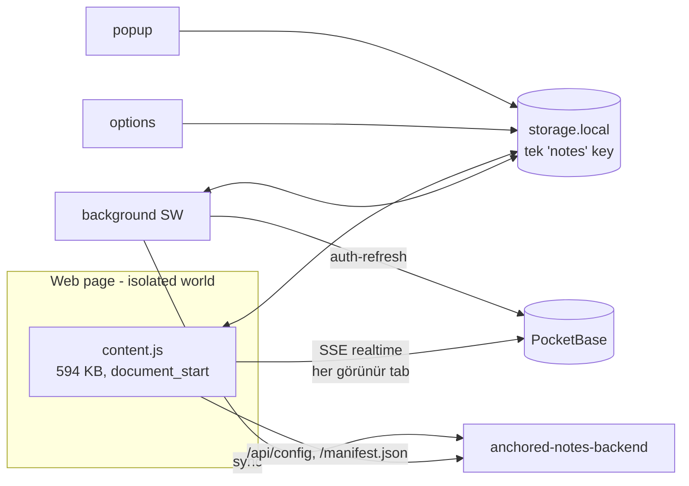
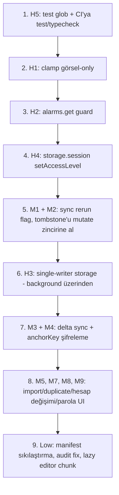

# Anchored Notes — Code Review (13 Sep 2026)

**Kapsam:** `src/` (Chrome MV3 extension: background, content script, popup, options, auth/sync/encryption), `video/` (Remotion + Drive upload CLI, uncommitted değişiklikler dahil), build scriptleri, CI workflow, bağımlılıklar.
**Yöntem:** Statik okuma + `npm run typecheck`, `npm test`, `npm run build`, `npm audit` (root ve `video/`).
**Sürüm:** `0.1.4` (`155785b`, `main`).

## 1. Özet

| Seviye | Adet | Öne çıkanlar |
| ------ | ---- | ------------ |
| High | 5 | Sync ping-pong loop (`clamp`), alarm reset (periodic sync fiilen çalışmayabilir), cross-context lost update, `storage.session` content script'ten erişilemez, root `npm test` kırık + CI test çalıştırmıyor |
| Medium | 12 | In-flight sync tetik kaybı, tombstone yarışı, her sync'te tüm notların yeniden şifrelenmesi, URL metadata'nın plaintext gitmesi, import akışı, per-tab SSE, update sonrası duplicate card, hesap değişiminde not sızıntısı, `window.prompt` ile şifre, Drive upload atomicity, Freesound key sızıntı riski |
| Low | 18 | Fingerprinting, `navigation` guard, manifest sıkılaştırma, bağımlılık CVE'leri, perf |

Genel izlenim: Kod kalitesi yüksek; auth refresh yarışları, XSS yüzeyi (`textContent` her yerde, shadow DOM), PKCE + `state` doğrulaması, AES-GCM random IV, logout'ta key wipe gibi konular doğru düşünülmüş. Sorunlar ağırlıkla **sync/storage tutarlılığı** ve **MV3 service worker lifecycle** etrafında toplanıyor.



---

## 2. High

### H1 — `clamp()` konumu `updatedAt` bump'lamadan kaydediyor → sync ping-pong loop

**Dosya:** `src/content/note-card.ts:391-402`, `src/storage.ts:209-219`, `src/sync.ts`

`clamp()` viewport'a sığmayan notu taşıyıp 300 ms sonra `deps.save(note)` çağırır; ancak `updatedAt` değişmez (`patch()` kullanılmıyor). Signed-in kullanıcıda zincir:

```mermaid
sequenceDiagram
  participant CS as content script (küçük pencere)
  participant ST as storage.local
  participant BG as background sync
  participant SV as server (strictly-newer LWW)
  CS->>ST: clamp → save(x=clamped, updatedAt=T)
  ST->>BG: onNotesChanged → scheduleSync (2s)
  BG->>SV: push (updatedAt=T)
  SV-->>BG: reddeder (T > T değil), kendi kopyası x=orijinal
  BG->>ST: applySyncResult: local.updatedAt > server? hayır → adopt (x=orijinal)
  ST->>CS: onNotesChanged → reconcile → update() → clamp()
  Note over CS,SV: ~2.3 saniyede bir sonsuz döngü; her turda TÜM notlar yeniden şifrelenip gönderilir (bkz. M3)
```

`storage.ts:123-125` yorumu server'ın "strictly-newer LWW" uyguladığını doğruluyor; `applySyncResult` eşit timestamp'te server kopyasını benimsiyor (`local.updatedAt > serverNote.updatedAt` false → `!sameNote` → adopt).

**Çözüm:** Clamp'ı yalnızca görsel yap, kalıcılaştırma:

```ts
// note-card.ts
function clamp(): void {
  const maxX = Math.max(0, window.innerWidth - note.w);
  const maxY = Math.max(0, window.innerHeight - note.h);
  const x = Math.max(0, Math.min(note.x, maxX));
  const y = Math.max(0, Math.min(note.y, maxY));
  el.style.left = `${x}px`;
  el.style.top = `${y}px`;
  // Do not mutate `note` or persist: the stored position stays authoritative.
}
```

Kalıcı olması isteniyorsa `patch({ x, y })` kullanılmalı (updatedAt bump) — ama bu da büyük ekrandaki cihazın konumunu küçük ekranın ezmesi demek; görsel-only tercih edilmeli.

### H2 — `chrome.alarms.create` her SW uyanışında alarmı sıfırlıyor → periodic sync / token refresh hiç tetiklenmeyebilir

**Dosya:** `src/background.ts:236`

```ts
chrome.alarms.create(SYNC_ALARM, { periodInMinutes: 5 });
```

MV3 service worker ~30 s idle sonrası öldürülür; her uyanışta top-level kod yeniden çalışır. Aynı isimle `create` mevcut alarmı **iptal edip yeniden oluşturur** → 5 dakikalık geri sayım sıfırlanır. Content script her sayfa yüklemesinde `GET_TAB_ID` gönderdiği için aktif gezinen bir kullanıcıda SW sık uyanır; 5 dakikadan kısa aralıklarla uyanış sürdüğü sürece alarm hiç fire etmez. README'de anlatılan "`refreshIfExpiringSoon` 5 dakikalık alarmda çalışır" ve "diğer cihazlardan değişiklikleri alarm çeker" mekanizmaları pratikte güvenilmez; yalnızca reaktif 401 yolu kalır.

**Çözüm:**

```ts
async function ensureSyncAlarm(): Promise<void> {
  const existing = await chrome.alarms.get(SYNC_ALARM);
  if (!existing) chrome.alarms.create(SYNC_ALARM, { periodInMinutes: 5 });
}
chrome.runtime.onInstalled.addListener(() => void ensureSyncAlarm());
chrome.runtime.onStartup.addListener(() => void ensureSyncAlarm());
```

### H3 — Tek `notes` key üzerinde cross-context read-modify-write → lost update

**Dosya:** `src/storage.ts:23-34` (`mutate`), tüm `saveNote`/`applySyncResult` çağrıları

`writeChain` yalnızca **aynı JS realm** içindeki yazmaları serileştirir. Ancak `notes` map'ini yazan context'ler: her tab'ın content script'i (drag, resize, edit, hide), popup, options, background (`applySyncResult`, `bumpNoteTimestamps`, `deleteTabNotes`). İki farklı context'in `get → transform → set` döngüleri iç içe geçtiğinde biri diğerinin yazdığını ezer (örn. tab A'da not sürüklenirken background sync tüm map'i yazar, ya da iki tab'da aynı anda edit). README'deki "sync only runs in the background worker (single context, no cross-context races)" ifadesi yalnızca `sync()` için doğru; storage yazmaları için değil.

**Çözüm (iki seçenek):**

1. **Single writer:** Tüm not mutasyonlarını `chrome.runtime.sendMessage({type:"SAVE_NOTE", note})` ile background'a yönlendir; background tek `writeChain` ile yazar. Content script'ler yalnızca okur.
2. **Per-note key:** `notes` map'i yerine `note:<id>` anahtarları; `chrome.storage.local.set({[`note:${id}`]: note})` tek key yazdığı için başka notların yazmalarıyla çakışmaz. `getNotesMap` → `chrome.storage.local.get(null)` + prefix filter. Migration gerekir.

Seçenek 1 daha az invaziv ve mevcut `mutate` mantığını korur.

### H4 — Content script'ten `chrome.storage.session` erişimi → `trackNoteEdited` her seferinde throw ediyor

**Dosya:** `src/umami.ts:100-103`, çağıran `src/content/note-card.ts:242,254`

`chrome.storage.session` varsayılan olarak yalnızca trusted context'lere (background, popup, options) açıktır; content script'te erişim `Access to storage is not allowed from this context` hatası verir. Kod tabanında `setAccessLevel` çağrısı yok. Sonuç: `note_edited` analytics eventi hiç gönderilmiyor ve her edit'te sayfa konsoluna unhandled rejection düşüyor (`void trackNoteEdited(...)`).

**Çözüm:**

```ts
// background.ts (onInstalled + onStartup)
void chrome.storage.session.setAccessLevel({ accessLevel: "TRUSTED_AND_UNTRUSTED_CONTEXTS" });
```

Not: Bu, `PENDING_WARNING_KEY` gibi session verilerini de content script'e açar (isolated world olduğu için sayfa JS'i göremez, kabul edilebilir). Alternatif: `trackNoteEdited` içindeki throttle'ı `storage.local` ile ya da background'a mesajla yap.

### H5 — Root `npm test` kırık; CI test ve typecheck çalıştırmıyor

**Dosya:** `package.json:12`, `.github/workflows/package.yml`

`node --import ./resolve-ts-hooks.mjs --test` argümansız çalıştığında repo genelinde `**/*.test.ts` toplar ve `video/scripts/lib/upload.test.ts`'i de yükler. O dosya extensionless import kullanır (`./job-id`), root resolver `.js → .ts` dönüşümü yapar ama extensionless çözemez:

```
ERR_MODULE_NOT_FOUND  video/scripts/lib/job-id
ℹ tests 119 / pass 118 / fail 1
```

CI workflow yalnızca `npm run package` çalıştırıyor; kırık test ve tip hataları main'e sessizce girer.

**Çözüm:**

```jsonc
// package.json
"test": "node --import ./resolve-ts-hooks.mjs --test 'src/**/*.test.ts'"
```

```yaml
# .github/workflows/package.yml
      - run: npm ci
      - run: npm run typecheck
      - run: npm test
      - run: npm run package
```

---

## 3. Medium

### M1 — `sync()` in-flight guard tetikleri düşürüyor

**Dosya:** `src/sync.ts:87-90`

Sync devam ederken gelen `sync()` çağrısı sessizce `return` eder. Round-trip sırasında yapılan bir edit, `onNotesChanged → scheduleSync → sync()` zinciriyle gelir ve düşer; `applySyncResult` başka bir değişiklik yazmazsa yeni sync'e kadar (alarm, bkz. H2) push edilmez.

**Çözüm:**

```ts
let inFlight = false;
let rerunRequested = false;

export async function sync(): Promise<void> {
  if (inFlight) { rerunRequested = true; return; }
  inFlight = true;
  try {
    await syncOnce();
  } finally {
    inFlight = false;
    if (rerunRequested) { rerunRequested = false; void sync(); }
  }
}
```

### M2 — Tombstone (`deletedNoteIds`) RMW serileştirilmemiş → not "dirilmesi"

**Dosya:** `src/storage.ts:106-121`

`recordDeletedNote` ve `clearDeletedNoteIds` `writeChain` dışında; hem aynı context'te hızlı iki silme, hem de content script'in `recordDeletedNote`'u ile background'un `clearDeletedNoteIds`'i arasındaki cross-context yarış tombstone kaybettirir → sonraki sync server kopyasını geri getirir.

**Çözüm:** Tombstone'ları `notes` ile aynı `mutate` zincirine al (ör. map içinde `__deleted` alanı ya da not objesinde `deleted: true` flag'i) veya H3'teki single-writer modeline dahil et.

### M3 — Her sync'te tüm notlar yeniden şifrelenip yükleniyor

**Dosya:** `src/sync.ts:108-117`

`syncable.map(toDTO)` her çağrıda tüm notları AES-GCM ile yeniden şifreler ve tamamını `upserts` olarak gönderir. Pro kullanıcıda yüzlerce not × (5 dk alarm + her edit + realtime tetik + M1 bounce) → gereksiz CPU/bant genişliği; server tarafında her not için LWW karşılaştırması. Ayrıca `applySyncResult` değişiklik yazdığında `onNotesChanged` ikinci bir sync tetikler (bounce).

**Çözüm:** Dirty tracking: `lastSyncedAt` (storage) ve yalnızca `updatedAt > lastSyncedAt` olan notları push et; server zaten authoritative set döndürüyor. `applySyncResult` çıkışını `onNotesChanged` handler'ında ayırt etmek için background'da "kendi yazmam" flag'i kullan.

### M4 — `anchorKey` (tam URL), scope, konum ve `hidden` plaintext gidiyor

**Dosya:** `src/sync.ts:50-66`

Custom password modunda README "true end-to-end encryption" diyor; ancak yalnızca `content` şifreleniyor. `anchorKey` sayfa notları için `origin+pathname+search` — kullanıcının hangi URL'leri (query string dahil) not aldığı server'da açık duruyor. Matching tamamen client-side olduğu için server'ın buna ihtiyacı yok.

**Çözüm:** `anchorKey` (ve tercihen `scope`) alanlarını da `encryptContent` ile şifrele; wire format değişimi için `enc:v1:` prefix zaten var, self-heal mekanizması legacy plaintext'i kabul ediyor. README'de "E2E" iddiasını buna göre netleştir.

### M5 — Import akışı: hata yutuluyor, tombstone yok, limit yok, `hidden` doğrulanmıyor

**Dosya:** `src/options/options.ts:504-536`

- `JSON.parse(text)` try/catch dışında → geçersiz dosyada `void importNotes(file)` unhandled rejection, kullanıcıya mesaj yok.
- `replaceAllNotes` mevcut notları tombstone'lamadan siler → signed-in kullanıcıda import'la kaldırılan notlar bir sonraki sync'te server'dan geri gelir ("replace" semantiği bozuk).
- Not limiti kontrolü yok (anonim 15 limiti import ile aşılabilir; server reddeder ama local'de kalır — tasarım gereği "kayıp yok" ama quota bypass).
- `isValidNote` `hidden`'ı doğrulamıyor; `createdAt/updatedAt` için `NaN` geçer (`typeof NaN === "number"`).

**Çözüm:**

```ts
async function importNotes(file: File): Promise<void> {
  let parsed: unknown;
  try {
    parsed = JSON.parse(await file.text());
  } catch {
    window.alert(t("invalidNotesFile", null));
    return;
  }
  ...
  if (await getAuthState()) {
    const removed = (await getAllNotes()).filter((n) => !incomingIds.has(n.id) && n.scope !== "tab");
    for (const n of removed) await recordDeletedNote(n.id); // export from storage.ts
  }
  await replaceAllNotes(parsed);
}
```

`isValidNote`'a `Number.isFinite` ve `(n.hidden === undefined || typeof n.hidden === "boolean")` ekle.

### M6 — Realtime SSE ve config fetch content script'ten, görünür her tab için ayrı bağlantı

**Dosya:** `src/content/index.ts:414-433`, `src/realtime.ts`, `src/config.ts:27`

- Her görünür + signed-in tab bir `EventSource` açar ve token'ı kendi `POST /api/realtime` isteğiyle gönderir. Birden çok pencere → N bağlantı; HTTP/1.1'de host başına 6 bağlantı limiti PocketBase'e giden diğer istekleri kuyruklayabilir.
- `getRuntimeConfig()` ve realtime istekleri sayfa origin'inden gider → backend/PocketBase'in CORS açık olmasına bağımlı; sayfanın `connect-src` CSP'si Chrome sürümüne göre bu istekleri engelleyebilir.
- Tab arka plana geçtiğinde `disconnect` çağrılıyor (iyi), ama `getRuntimeConfig` cache'i content script başına.

**Çözüm:** Tek bağlantıyı background'da (MV3'te uzun ömür için `chrome.offscreen` document) tut ya da "leader tab" seçimi yap (`chrome.storage.session` ile lease). En azından `BACKEND_URL/api/config` ve subscribe POST'unu background'a mesajla yaptır.

### M7 — Extension update sonrası orphaned content script + yeni bundle → duplicate card

**Dosya:** `src/content/index.ts:140-152` (`mountHost`), `src/inject.ts`

`inject.ts` guard'ı temizleyip yeni `content.js` enjekte eder; `mountHost` mevcut host'u id ile bulup **eski shadow root'u** yeniden kullanır. Eski (orphaned) script'in kartları DOM'da kalır, yeni script `cards` map'i boş olduğu için aynı notları tekrar oluşturur → aynı not iki kez görünür; eski kartlar storage'a yazamaz ama sürüklenebilir.

**Çözüm:** `mountHost`'ta mevcut host bulunduğunda `existing.remove()` yapıp temiz host oluştur (eski script `onNotesChanged` almadığı için zaten ölüdür), ya da `clearInjectionGuard` içinde `document.getElementById("anchored-notes-host")?.remove()`.

### M8 — Hesap değişiminde local notlar yeni hesaba sessizce push ediliyor

**Dosya:** `src/auth.ts:127-131` (`logout` notları korur), `src/sync.ts`

A hesabından çıkıp B ile girildiğinde A'nın (veya anonim kullanımın) tüm local notları B'nin hesabına yüklenir. Paylaşılan cihazda gizlilik sızıntısı; ayrıca A'nın notları B'nin limitini tüketir.

**Çözüm:** Sign-in sonrası local not varsa ve önceki oturum farklı bir e-posta ile ise (ya da anonimden ilk girişse) kullanıcıya sor: "N local notu bu hesaba yükle / local'de tut / sil". Son oturumun e-postasını `lastAccountEmail` olarak sakla.

### M9 — Şifre `window.prompt` ile alınıyor; minimum güç yok; `encCheck` offline brute-force oracle

**Dosya:** `src/options/options.ts:326-335`, `src/encryption.ts:164-182`

- `prompt()` girdiyi maskelemez (shoulder-surfing) ve tarayıcı otomatik doldurma/parola yöneticisiyle çalışmaz.
- Uzunluk/güç kontrolü yok. `encSalt + encCheck` server'da; DB'ye erişen biri PBKDF2-600k maliyetiyle offline deneme yapabilir — zayıf parolalar kırılabilir.

**Çözüm:** Options sayfasında `<input type="password">` + tekrar alanı; min 12 karakter (veya zxcvbn benzeri skor); UI'da parola kaybının geri dönüşsüz olduğunu zaten söylüyorsunuz, buraya "güçlü parola" uyarısı ekle.

### M10 — "Pushed but not returned" notlar tombstone olmadan local'den siliniyor

**Dosya:** `src/storage.ts:220-225`

Server bir notu ne `notes` ne `rejected` ne `failed` içinde döndürmezse (bug, kısmi yanıt, tombstone purge) local kopya silinir. Server zaten `deleted=true` tombstone döndürüyor; bu ek yol yalnızca tutarsız server yanıtında devreye girer ve sonucu veri kaybı.

**Çözüm:** Bu dalı kaldır ya da yalnızca `data.notes.length > 0 && !data.partial` gibi bir güvenceyle çalıştır; şüpheli durumda notu local'de tut ve `console.warn` ile logla.

### M11 — Drive upload: delete-then-create atomik değil, duplicate temizlemiyor, file id her seferinde değişiyor

**Dosya:** `video/scripts/upload-drive.ts:159-179`

`deleteChildIfExists` `pageSize: 1` ile yalnızca bir eşleşmeyi siler (önceki yarım kalan çalıştırmalar birikir); `files.delete` sonrası `files.create` başarısız olursa önceki yükleme de gitmiştir; her yüklemede `webViewLink` değişir (paylaşılan linkler kırılır).

**Çözüm:**

```ts
async function uploadFile(...) {
  const existing = await findChild(drive, parentId, title, null);
  const media = { mimeType, body: createReadStream(filePath) };
  const res = existing
    ? await drive.files.update({ fileId: existing, media, fields: "id, name, webViewLink" })
    : await drive.files.create({ requestBody: { name: title, parents: [parentId] }, media, fields: "id, name, webViewLink" });
  return res.data;
}
```

`findChild`'da `pageSize` kaldırılıp birden çok eşleşme varsa uyarı ver.

### M12 — Freesound API key, API yanıtından gelen preview URL host'una gönderiliyor

**Dosya:** `video/scripts/sfx-fetch.ts:173`

```ts
const download = await fetch(previewUrl, {headers: {Authorization: `Token ${apiKey}`}});
```

`previewUrl` API yanıtından gelir; host `freesound.org` dışına işaret ederse key o host'a sızar. Preview'lar zaten public.

**Çözüm:** `new URL(previewUrl).hostname` `freesound.org` ile bitmiyorsa header gönderme (ya da hiç gönderme).

---

## 4. Low

| ID | Dosya | Bulgu | Öneri |
| -- | ----- | ----- | ----- |
| L1 | `src/content/index.ts:477` | `if (navigation)` — global tanımsızsa `ReferenceError` (Firefox/Safari portu) | `typeof navigation !== "undefined"` |
| L2 | `src/content/index.ts:442` | `getTabId()` reject'i yakalanmıyor (SW uyanamazsa / context invalidated) | `.catch(() => undefined)` |
| L3 | `manifest.json:43-52` | `web_accessible_resources` `<all_urls>` → siteler `chrome-extension://<id>/icons/icon-128.png` ile extension'ı fingerprint edebilir | `"use_dynamic_url": true` |
| L4 | `manifest.json` | `minimum_chrome_version` yok; `storage.session`, `injectImmediately`, Navigation API kullanılıyor | `"minimum_chrome_version": "110"` |
| L5 | `manifest.json:8-15` | `activeTab` `<all_urls>` ile gereksiz; CWS review'da ek soru | Kaldır (TODO.md'deki justification'ı güncelle) |
| L6 | `src/site-manifest.ts:19-21` | `<link rel=manifest>` yoksa her sayfada `/manifest.json` fetch → site tarafından tespit edilebilir, log gürültüsü, ekstra istek | Yalnızca link varsa veya sayfada görünür not varsa fetch et |
| L7 | `src/auth.ts:73-77` | `methods.oauth2.enabled` kontrol edilmiyor; eşzamanlı iki `LOGIN` mesajı iki `launchWebAuthFlow` açar | `enabled` kontrolü + in-flight login promise |
| L8 | `src/note-title.ts:20` | `"(empty)"` lokalize değil (badge listesi) | `t("empty")` ile çağıran tarafta karşıla |
| L9 | `src/background.ts:216,246` | `sync()` hataları unhandled rejection (TODO.md'de de var) | `.catch` + kullanıcıya görünür durum |
| L10 | `src/content/note-card.ts:325-366` | `pointercancel` ele alınmıyor → drag/resize state takılı kalabilir | `pointercancel` dinleyicisinde `dragStart = null` |
| L11 | `src/content/index.ts:506-508` | İki hızlı `CREATE_NOTE` limit kontrolünü aynı snapshot'la geçer (+1 bypass) | Limit kontrolünü `mutate` içine al |
| L12 | `video/scripts/voiceover.ts:18`, `sfx-fetch.ts:3` | `dotenv/config` cwd'den `.env` okur; `upload-drive.ts` `videoRoot/.env` — tutarsız | Her yerde `loadEnv({ path: join(videoRoot, ".env") })` |
| L13 | `.github/workflows/package.yml` | `permissions:` bloğu yok (default token yetkisi geniş); action'lar tag ile pinlenmiş | `permissions: contents: read`, SHA pin |
| L14 | `package.json`, `video/package.json` | `npm audit`: root — esbuild ≤0.24.2 (moderate, dev-only), nanoid 4-5.x (high, Milkdown üzerinden bundle'a giriyor, negatif size senaryosu burada yok); video — fast-uri, js-yaml, nanoid (high) | `npm audit fix`; esbuild'i 0.25+'a taşı |
| L15 | Milkdown link mark | `href` şeması sanitize edilmiyor; options sayfasında MV3 CSP `javascript:`'i engeller, sayfa içinde (content script) link sayfa context'inde açılır | Link mark'ına `http(s)/mailto` whitelist; `rel="noopener"` |
| L16 | `dist/content.js` 594 KB | Milkdown + ProseMirror her sayfaya `document_start`'ta yükleniyor | Editor'ü ayrı chunk yap, ilk kart mount'unda `import()` ile yükle; MV3'te `web_accessible_resources` + dynamic import çalışır |
| L17 | `src/encryption.ts` default mode | Key `userId + encSalt`'tan türer; ikisi de server'da → operatör türetebilir (README dürüst; pazarlamada "E2E" yalnızca custom password için kullanılmalı) | Store listing / welcome sayfasını kontrol et |
| L18 | `src/background.ts:201-208` | `"!"` badge popup açılmazsa tab kapanana kadar kalır | `setTimeout` ile 10 s sonra temizle |
| L19 | `src/auth.ts:249-259`, `src/sync.ts:123-126` | Backend'in token dışı sebeple 401 vermesi (JWT doğrulama konfig hatası) → tüm cihazlarda logout + key wipe | Backend 401 body'sinde `code: "token_expired"` ayrımı; diğer 401'leri transient say |
| L20 | `src/content/index.ts:140-151` | `document.documentElement.replaceChildren()` / `document.write` yapan sayfalarda host kaybolur, `reconcile` eski shadow'a yazar | `MutationObserver` ile host'un bağlı kalmasını kontrol et / `isConnected` kontrolü |
| L21 | `src/options/options.ts:432-436` | `anchorKey.startsWith("http")` → `href`; sync'ten gelen anchorKey'e güveniliyor | `new URL()` ile parse et, yalnızca `http:`/`https:` protokolünde link üret |
| L22 | `src/background.ts:94-107` | `onInstalled` → `injectIntoOpenTabs` tüm http(s) tab'lara 594 KB enjekte eder (yüzlerce tab'da CPU spike) | Yalnızca aktif pencerenin tab'ları; diğerleri odaklandığında (`onActivated`) |

---

## 5. Güvenlik değerlendirmesi

**Doğru yapılanlar**

- DOM yazımları `textContent`/`title` ile; `innerHTML`, `eval`, `insertAdjacentHTML` yok. UI shadow DOM içinde (`mode: "open"` — sayfa JS'i shadow root'a erişebilir; `closed` yapılabilir ama isolated world zaten sayfadan ayırıyor).
- OAuth: PKCE (`codeVerifier`) + `state` doğrulaması (`auth.ts:98-100`), redirect URL `chrome.identity.getRedirectURL()`.
- Token refresh: `rejected` / `unavailable` / `refreshed` ayrımı ve account-switch yarışı testlerle kapsanmış (`auth.test.ts`, `realtime.test.ts`).
- Şifreleme: PBKDF2-SHA256 600k → AES-256-GCM, her şifrelemede rastgele 12 byte IV, canary tabanlı verifier, logout/delete'te key wipe, 409 ile stale key tespiti.
- Analytics: PII yok, URL yok, `anonymousIdentifier` local UUID.
- `package.mjs` store zip'inden `key`'i çıkarıyor; `.env` gitignored; kodda gömülü secret yok (yalnızca public Umami website id ve backend URL).
- `chrome.runtime.onMessage` yalnızca aynı extension'dan mesaj alır; `onMessageExternal` kullanılmıyor.

**Riskler (yukarıdaki maddelerle birlikte)**

- Threat model: token ve raw AES key `chrome.storage.local`'de plaintext (extension-private). Cihaz ele geçirildiyse oyun zaten bitmiştir; kabul edilebilir, ancak README'ye açıkça yazılmalı.
- M4: URL metadata'sı şifrelenmiyor — "E2E" iddiasıyla çelişiyor.
- M6: Token'ın content script (isolated world) içinde ağ isteğine girmesi; sayfa JS'i göremez ama saldırı yüzeyi büyür (ör. gelecekte bir isolated-world bypass).
- M8: Paylaşılan cihazda hesaplar arası not sızıntısı.
- L3/L6: Extension'ın siteler tarafından tespit edilebilirliği.

---

## 6. Test ve CI durumu

| Kontrol | Sonuç |
| ------- | ----- |
| `npm run typecheck` | Temiz |
| `npm test` (root) | 118/119 — `video/.../upload.test.ts` resolver hatasıyla düşüyor (H5) |
| `npm run build` | Temiz; `content.js` 594 KB, `options.js` 544 KB, `background.js` 113 KB, `popup.js` 110 KB (popup/background boyutu 16 locale dictionary'nin tamamının bundle'a girmesinden) |
| `npm audit` root | 1 moderate (esbuild, dev), 1 high (nanoid, bundle'da) |
| `npm audit` video | 1 moderate (esbuild), 3 high (fast-uri, js-yaml, nanoid) — `npm audit fix` ile çözülür |
| CI | Yalnızca `npm run package`; test/typecheck yok; `permissions` yok |

Eksik test kapsamı (öneri): `applySyncResult` (H1/M10 senaryoları), `storage.ts` tombstone yarışı (M2), `sync()` in-flight rerun (M1), `importNotes` doğrulama (M5). Bunlar pure/mock'lanabilir modüller; mevcut `testing.ts` altyapısıyla yazılabilir.

---

## 7. Uncommitted `video/` değişiklikleri (Drive upload CLI refactor)

Diff incelendi: `channelSlug` argümanının kaldırılması, `CHANNEL_SLUG` sabiti, `parseUploadCliArgs`, `requireYoutubeDriveFolderId`, `formatUploadResult`, `prepare-upload` komutu ve testleri. Mantık tutarlı, testler `tsx --test` ile geçiyor, README güncellenmiş. Notlar:

- `upload-drive.ts:51-53`: `!stdin.isTTY` kontrolü `requireYoutubeDriveFolderId()`'den sonra — sırası önemli değil ama ikisi de top-level `throw`; `parseUploadCliArgs` gibi `console.error + exit(1)` ile tutarlı hale getirilebilir.
- M11 ve M12 bu alt projeye ait.
- `prepare-upload.ts:26-29` `TAGS` yalnızca `en`/`tr`; `pt_BR` gibi diller `en`'e düşer — bilinçliyse yorumla belirt.

---

## 8. Öncelikli aksiyon planı



1–4 tek başına küçük, düşük riskli değişiklikler; ilk sürüm güncellemesinde çıkarılabilir. 5–7 sync katmanında koordineli değişiklik gerektirir (backend LWW davranışıyla birlikte doğrulanmalı). 8–9 ürün kararı içerir.
